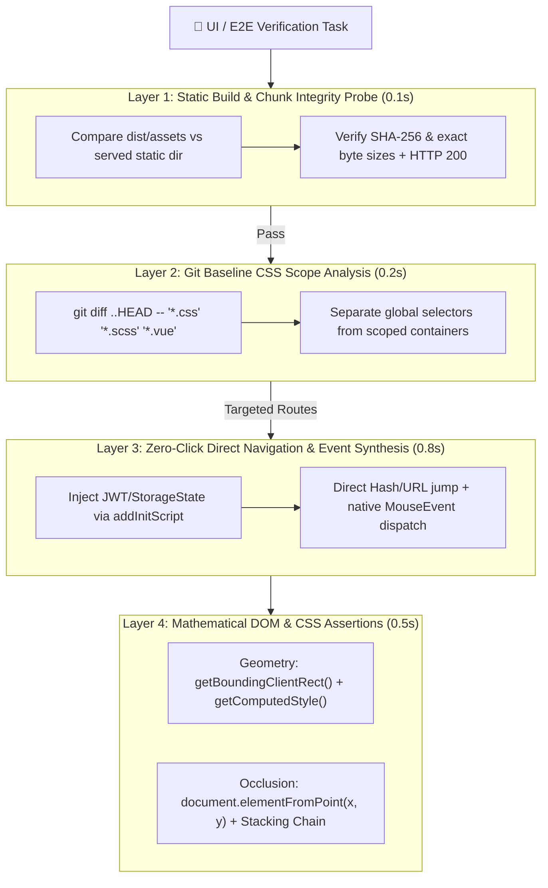

# ⚡ fast-e2e-inspector

> **"Don't watch an AI agent click through 10 menus and guess pixels from screenshots. Prove UI correctness in 1 second with static probes and DOM geometry math."**
>
> **拒绝慢吞吞的浏览器点击与“肉眼看截图猜像素”——用前置静态探针 + DOM 几何数学断言，让 AI Coding Agent 在 1 秒内完成 E2E 与样式回归验证。**

[](./SKILL.md)
[](https://playwright.dev/)
[](#why-not-traditional-browser-mcp)
[](./LICENSE)

---

## 🧐 Why Not Traditional Browser MCP? / 为什么不用传统的浏览器 MCP？

When AI coding agents (Claude Code, Antigravity, Cursor, Copilot) verify frontend bugs using traditional interactive Browser MCPs, they fall into **4 costly traps**:

1. **Slow Menu-Clicking Loops (30s–90s per check)**: Logging in via UI $\rightarrow$ waiting for dashboard $\rightarrow$ clicking level-1 menu $\rightarrow$ clicking level-2 menu $\rightarrow$ opening a detail tab.
2. **Eyeballing Screenshots Instead of Doing Math**: Uploading 1920×1080 PNGs on every step consumes thousands of tokens, yet Vision LLMs still struggle to tell whether a container is `24px` narrower or why `max-width` is constraining a flexbox child.
3. **`toBeVisible()` Lies About Z-Index Occlusion**: Standard visibility checks return `true` even when a dropdown menu is completely covered by a sticky `<el-table>` fixed column with a higher stacking context.
4. **Launching a Browser for Build-Layer Problems**: Waiting 15 seconds for a headless browser to time out on a white screen when a `0.1s` static chunk integrity probe could immediately reveal a truncated or unsynced JS bundle.

---

## 🚀 The 4-Layer Short-Circuit Architecture / 四层短路极速验证架构

`fast-e2e-inspector` teaches your AI agent to verify UI from fastest (`0.1s`) to deepest (`1.5s`), short-circuiting unnecessary work at every layer:



### Benchmark Comparison / 效率对比

| Dimension | Traditional Browser MCP (`playwright-mcp`) | ⚡ `fast-e2e-inspector` |
| :--- | :--- | :--- |
| **Auth & Navigation** | Fill `/login` form $\rightarrow$ click 4 nested menus (~15s) | `addInitScript` token injection + direct deep URL jump (**0.4s**) |
| **Layout / Width Check** | Take full-page screenshot $\rightarrow$ LLM guesses alignment | Exact `leftGapPx`, `rightGapPx`, `fillRatio` & `getComputedStyle` JSON (**0.1s**) |
| **Z-Index Occlusion** | Often missed (`toBeVisible()` returns `true` when covered) | Coordinate hit-testing via `document.elementFromPoint(x, y)` + stacking context chain (**100% deterministic**) |
| **White-Screen Debugging** | Wait for browser timeout & inspect console | `check-chunks.sh` compares `dist` vs `static` byte sizes in **0.1s** |
| **Special Interactions** | Hard to trigger middle-click / wheel / complex events | Native `new MouseEvent('auxclick', { button: 1 })` synthesis in **5ms** |
| **Token Consumption** | 15,000 – 50,000 tokens (DOM trees + PNGs) | **< 800 tokens** (structured JSON diagnostic output) |

---

## 🛠️ Installation / 安装使用

### Option 1: Install via `skills` CLI (Recommended)
```bash
npx skills add tomwu618/fast-e2e-inspector
```

### Option 2: Clone into Your Agent's Skills Directory

**For Antigravity:**
```bash
git clone git@github.com:tomwu618/fast-e2e-inspector.git ~/.gemini/antigravity/skills/fast-e2e-inspector
```

**For Claude Code / Cursor:**
```bash
git clone git@github.com:tomwu618/fast-e2e-inspector.git .claude/skills/fast-e2e-inspector
```

### Option 3: Standalone CLI Usage
```bash
git clone git@github.com:tomwu618/fast-e2e-inspector.git
cd fast-e2e-inspector
npm install
```

---

## 🔬 Battle-Tested Scenarios / 四大实战高频场景

### 1. Prove Container Width & Layout Alignment (`getBoundingClientRect` + `getComputedStyle`)
Instead of asking *"Does this form look narrower than before?"*, run `inspect-ui.mjs` to measure the exact pixel gaps between a view and its layout wrapper:

```bash
node scripts/inspect-ui.mjs \
  --url "http://localhost:3000/#/orders/detail?id=1001" \
  --parent ".work-content" \
  --target ".detail-card" \
  --token "YOUR_JWT_TOKEN"
```

**Output (in ~1.2s):**
```json
{
  "elapsedMs": 1180,
  "layout": {
    "parentSelector": ".work-content",
    "targetSelector": ".detail-card",
    "parentRect": { "left": 220, "width": 1700 },
    "targetRect": { "left": 236, "width": 1668 },
    "leftGapPx": 16,
    "rightGapPx": -16,
    "horizontalFillRatio": 0.9812,
    "targetComputedStyle": {
      "width": "1668px",
      "maxWidth": "none",
      "margin": "0px",
      "padding": "20px",
      "boxSizing": "border-box"
    }
  }
}
```

### 2. Detect Z-Index & Sticky-Column Occlusion (`document.elementFromPoint`)
When a top-right account dropdown (`.user-dropdown`) opens above a data table with fixed columns (`.el-table__fixed-right`), `inspect-ui.mjs` samples coordinates across the dropdown and walks the DOM to expose the exact offending stacking context:

```bash
node scripts/inspect-ui.mjs \
  --url "http://localhost:3000/#/orders/list" \
  --clickBeforeOcclude ".user-avatar-trigger" \
  --occlude ".user-dropdown" \
  --token "YOUR_JWT_TOKEN"
```

**Output when occluded:**
```json
{
  "occlusion": {
    "selector": ".user-dropdown",
    "isOccluded": true,
    "targetStackingChain": [
      { "tag": "header", "className": "nav-top", "position": "relative", "zIndex": "10" }
    ],
    "hits": [
      {
        "point": "center",
        "x": 1820,
        "y": 115,
        "occluded": true,
        "hitTag": "td",
        "hitClass": "el-table__cell",
        "occluderStackingChain": [
          { "tag": "div", "className": "el-table__fixed-right", "position": "absolute", "zIndex": "30" }
        ]
      }
    ]
  }
}
```

### 3. Catch White-Screen & Mid-Build Chunk Race Conditions (`check-chunks.sh`)
Before launching a browser for a broken route, verify that every compiled Vite/Webpack asset in `dist/assets` was completely synced to the backend static directory:

```bash
bash scripts/check-chunks.sh ./frontend/dist ./build/resources/main/static http://localhost:9020
```

**Output when a large chunk was copied mid-write:**
```text
=== [1/3] Checking index.html sync ===
[OK] index.html hashes match (e3b0c44298fc1c149afbf4c8996fb92427ae41e4649b934ca495991b7852b855)
=== [2/3] Checking all JS/CSS chunks for existence and exact byte size ===
[TRUNCATED/MISMATCH] assets/address-data-C9x8a1.js: dist=5134208B vs static=2097152B
Checked 142 asset chunks: 0 missing, 1 size mismatches.
```

### 4. Synthesize Native DOM Events (`examples/assertion-recipes.mjs`)
Test middle-mouse-button tab closing (`button: 1` `mousedown` + `auxclick`) or batch-scan dozens of routes for `ChunkLoadError` in milliseconds:

```js
import { dispatchMiddleClickClose, assertFullWidthLayout, assertNotOccluded } from './examples/assertion-recipes.mjs';

const res = await dispatchMiddleClickClose(page, '.work-tab-item', 1);
console.assert(res.closedSuccessfully, 'Middle-click should close the active work tab');
```

---

## 📂 Repository Structure / 目录结构

```text
fast-e2e-inspector/
├── SKILL.md                        # Core Agent Skill specification & 4-layer workflow instructions
├── scripts/
│   ├── inspect-ui.mjs              # Standalone headless Playwright geometry & occlusion CLI
│   └── check-chunks.sh             # Sub-second build artifact & HTTP chunk integrity probe
├── examples/
│   └── assertion-recipes.mjs       # Reusable Playwright helpers (width, occlusion, middle-click, batch scan)
├── package.json
├── LICENSE
└── README.md
```

---

## 📄 License

Released under the [MIT License](./LICENSE).
